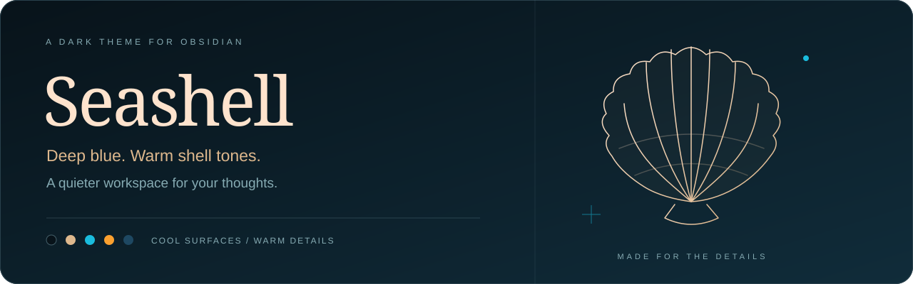
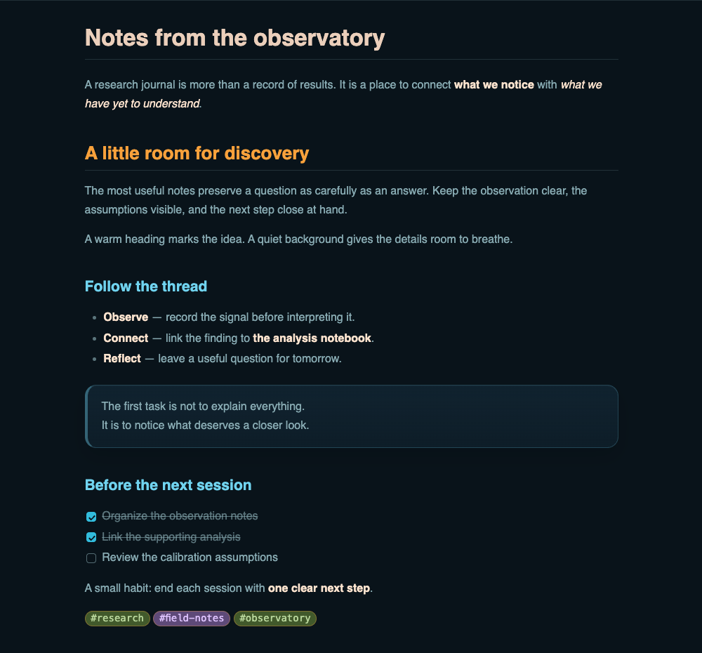
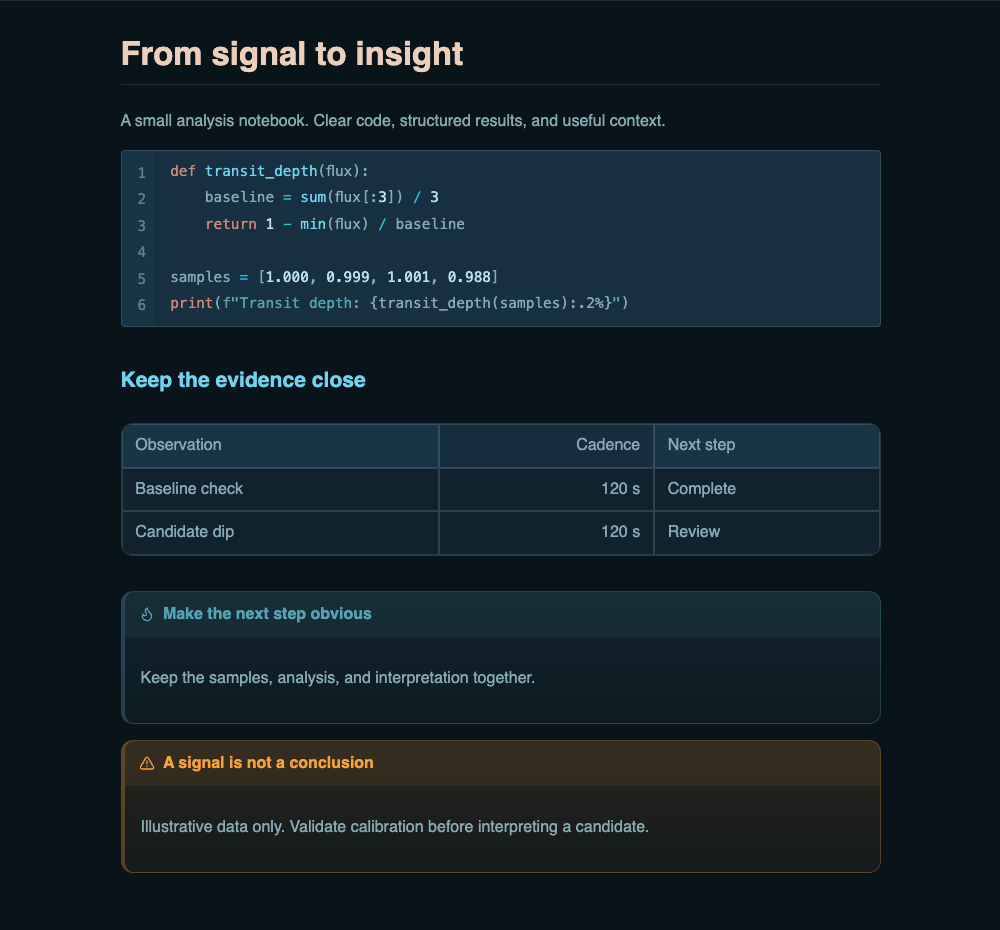

  

  A dark theme for <a href="https://obsidian.md">Obsidian</a>, with warm typography, 
  layered blue surfaces, and a little cyan and amber.

  

  
  &nbsp;
  

  <a href="#install"><strong>Get Seashell</strong></a>
  &nbsp; · &nbsp;
  <a href="#preview">Take a look</a>
  &nbsp; · &nbsp;
  <a href="https://github.com/gabrielfrimodig/obsidian-seashell/issues">Share an idea</a>

 

Dark mode, down to the details. Fonts and plugins may affect your setup’s appearance.

## Cool surfaces. Warm details.

<table>
  <tr>
    <td width="33%" valign="top">
      <h3>Room to focus</h3>
      Deep blue backgrounds, subtle borders, and layered surfaces give your notes room to breathe.
    </td>
    <td width="33%" valign="top">
      <h3>A warmer read</h3>
      Shell-toned text and distinct heading colors bring structure to long notes.
    </td>
    <td width="33%" valign="top">
      <h3>Small things, considered</h3>
      Coordinated code blocks, tables, callouts, and navigation carry the palette through your workspace.
    </td>
  </tr>
</table>

## Preview

<table>
  <tr>
    <td width="50%">
      
    </td>
    <td width="50%">
      
    </td>
  </tr>
  <tr>
    <td><strong>01 / Room to read</strong> Reading view · headings · links</td>
    <td><strong>02 / Details that matter</strong> Code · tables · callouts</td>
  </tr>
</table>

## Install

**Obsidian 1.14.4+ · Dark mode only · No required plugins**

1. Open **Settings → Appearance → Themes → Manage**.
2. Search for **Seashell**, then install and select it.
3. Set **Base color scheme** to **Dark**.

[View Seashell in the community directory →](https://community.obsidian.md/themes/seashell)

Prefer a manual installation?

Create a `Seashell` folder inside your vault’s `.obsidian/themes/` directory, copy `theme.css` and `manifest.json` into it, then select **Seashell** in Appearance settings.

## Make it yours

Choose your **interface font, text font, monospace font, and text size** in **Settings → Appearance**. Seashell provides local font fallbacks and follows your choices.

For more control, install and enable the optional [Style Settings](https://github.com/community-archive/obsidian-style-settings) community plugin, then open **Settings → Style Settings → Seashell**. Adjust note width, line spacing, code size, code wrapping in reading view, heading colors, link underlines, callout fills, and whether accents follow Seashell or Obsidian. Note width uses Obsidian’s **Readable line length** setting; editor code wrapping follows Obsidian.

The theme works without Style Settings. Its default accent and heading colors remain Seashell’s own, and all fonts resolve locally.

## Make it better

Ideas from the community are welcome. [Open an issue](https://github.com/gabrielfrimodig/obsidian-seashell/issues/new) to suggest an improvement, request a feature, or share feedback. Contributions through pull requests are welcome too.

For visual bugs, include your Obsidian version, operating system, affected view, and a screenshot without sensitive information.

About the live statistics

Downloads come from [Obsidian’s theme statistics](https://releases.obsidian.md/stats/theme). Health and Review show the labels from [Seashell’s community scorecard](https://community.obsidian.md/themes/seashell#scorecard).

[Shields.io](https://shields.io) updates the badges automatically, subject to source and image caching. They request a one-hour cache lifetime. Health and Review use the experimental [Dynamic Regex badge](https://shields.io/badges/dynamic-regex-badge); changes to the community page’s HTML may require adjusting them. Badge colors are decorative; the live text gives the rating.

---

  Made by <a href="https://github.com/gabrielfrimodig">gabrielfrimodig</a>
  &nbsp; · &nbsp;
  <a href="LICENSE">MIT licensed</a>
  &nbsp; · &nbsp;
  CSS only. Local fonts.

