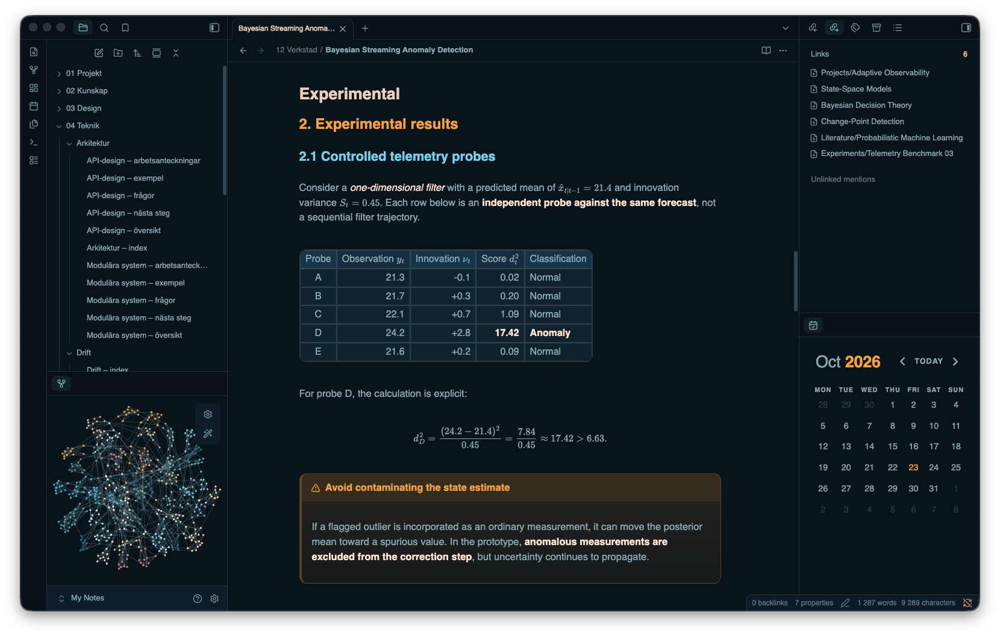

# Seashell

**Deep blue. Warm shell tones. A quieter workspace.**

A dark-only theme for [Obsidian](https://obsidian.md), built around warm typography, layered surfaces, and precise cyan and amber accents.

**Dark mode** · **CSS only** · **Local fonts** · **MIT licensed**

## ✦ Design language

Seashell gives notes and navigation a consistent visual rhythm. A blue-black foundation anchors the workspace; warm text and distinct heading colors establish hierarchy. Subtle borders, rounded controls, and restrained highlights define surfaces without overwhelming the content.

| Foundation | Shell | Cyan | Amber | Selection |
| :--- | :--- | :--- | :--- | :--- |
| `#08131a` | `#deb88d` | `#1abcdd` | `#fba02f` | `#1e4862` |

- **Connected surfaces** — coordinated styling for the editor, reading view, navigation, search, and settings.
- **Structured content** — dedicated treatments for headings, tables, blockquotes, callouts, and code blocks.
- **Adaptive layout** — spacing and title adjustments for narrow windows.
- **Self-contained styling** — local font stacks with system fallbacks; no remote fonts or assets.

## Installation

Requires **Obsidian 1.14.4 or later**.

1. Create a `Seashell` folder inside your vault’s `.obsidian/themes/` directory.
2. Copy `theme.css` and `manifest.json` into it.
3. In **Settings → Appearance**, select **Seashell** and set **Base color scheme** to **Dark**.

**Seashell supports dark mode only.** The screenshot shows the intended appearance; installed fonts and enabled plugins may affect rendering.

## Theme structure

All styling lives in `theme.css`, with no build step or runtime JavaScript. Shared palette tokens and semantic Obsidian variables define the foundation; numbered sections organize component styles, typography overrides, and narrow-window adjustments.

## Feedback & license

When reporting a visual issue, include your Obsidian version, operating system, affected view, and a screenshot using non-sensitive content.

Released under the [MIT License](LICENSE).
